<p align="center">
  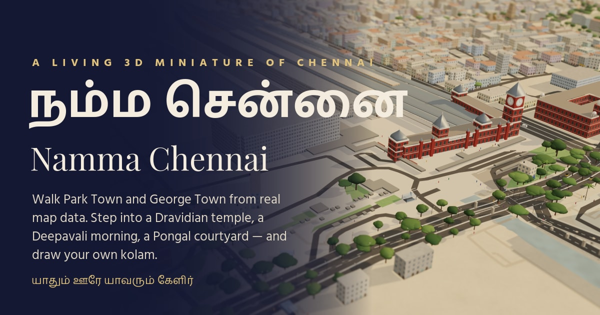
</p>

<h1 align="center">Namma Chennai · நம்ம சென்னை</h1>

<p align="center">
  <b>A small piece of Chennai you can walk around in.</b><br>
  Real streets, a working temple, four festivals, kolams you can draw, and photos that all go through Cloudinary.
</p>

<p align="center">
  
  
  
  
  
</p>

---

A city map tells you where things are. It doesn't tell you what happens on the threshold of a house at five in the morning, or what a temple gate looks like at dusk. We wanted something that does.

So we built about two kilometres of old Chennai around Chennai Central: Park Town, George Town, Periamet and Chintadripet. It's made in 3D from real OpenStreetMap data. You can switch it between an ordinary morning, a Margazhi dawn, Thai Pongal and a Deepavali night. You can walk into a Murugan temple and a few homes, draw a kolam and leave it on a doorstep, turn that kolam into a postcard, and add your own memories of the city.

<p align="center">
  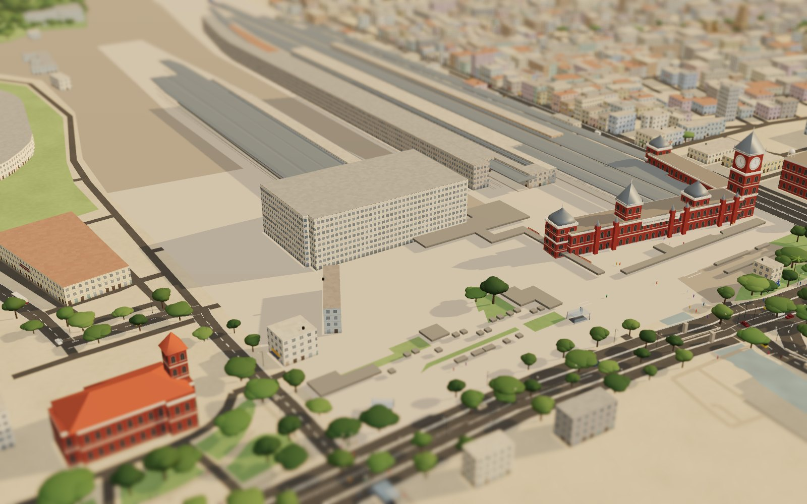
  <br><sub>Chennai Central, Victoria Public Hall and the platform sheds, as a miniature in golden-hour light.</sub>
</p>

---

## A look around

<table>
  <tr>
    <td width="50%">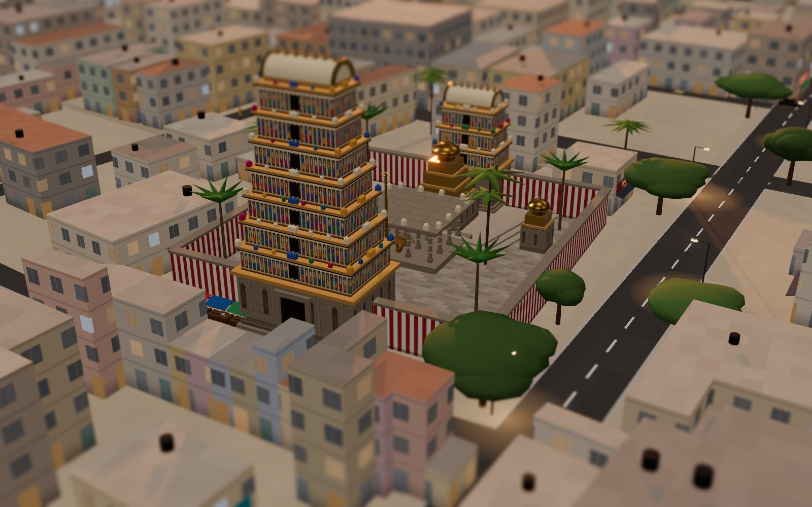<br><sub><b>Kandha Kottam at dusk.</b> A seven-tier gopuram, kaavi-striped walls and the temple tank next to it.</sub></td>
    <td width="50%">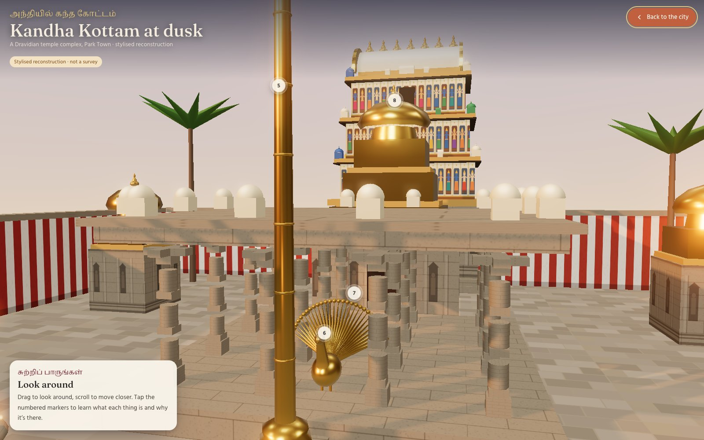<br><sub><b>Step inside the temple.</b> The flagstaff, Murugan's peacock, the pillared hall and the sanctum tower.</sub></td>
  </tr>
  <tr>
    <td>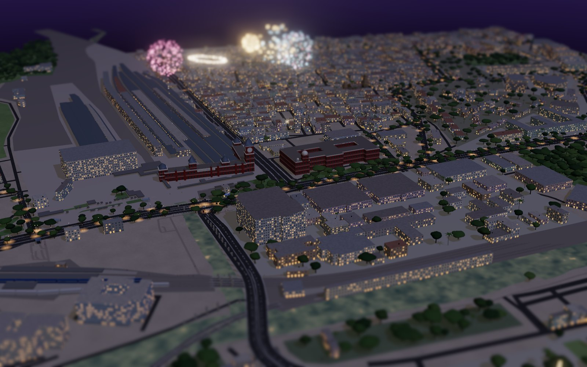<br><sub><b>Deepavali night.</b> Lamps on every threshold and fireworks over the open grounds.</sub></td>
    <td>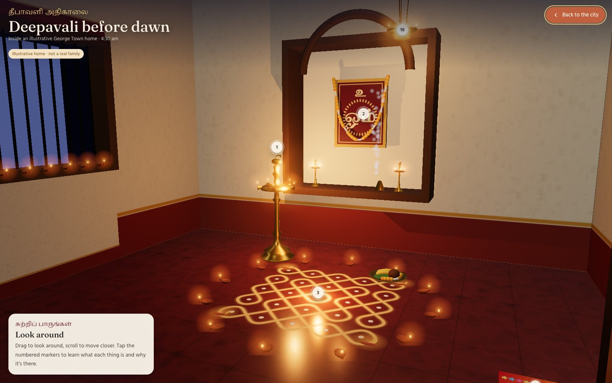<br><sub><b>Deepavali at 4:30 am.</b> A brass kuthuvilakku, a kolam ringed with agal lamps, and sweets.</sub></td>
  </tr>
  <tr>
    <td>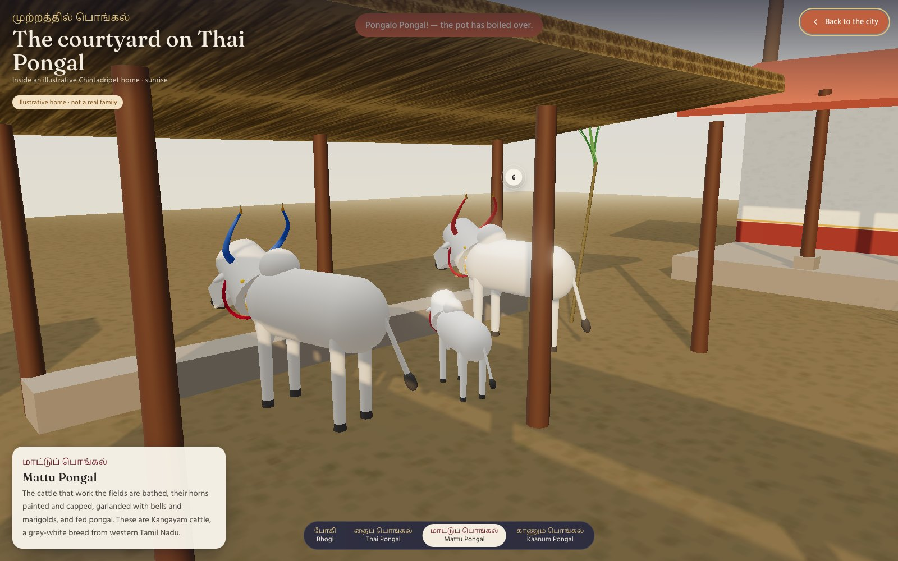<br><sub><b>Mattu Pongal.</b> Kangayam cattle with painted horns, in a courtyard you can step through day by day.</sub></td>
    <td>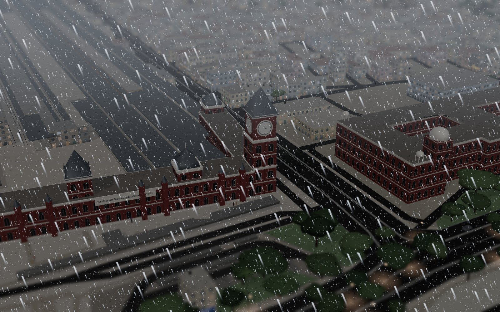<br><sub><b>Monsoon.</b> The roads go glossy and lightning picks out the tallest things in the city.</sub></td>
  </tr>
  <tr>
    <td>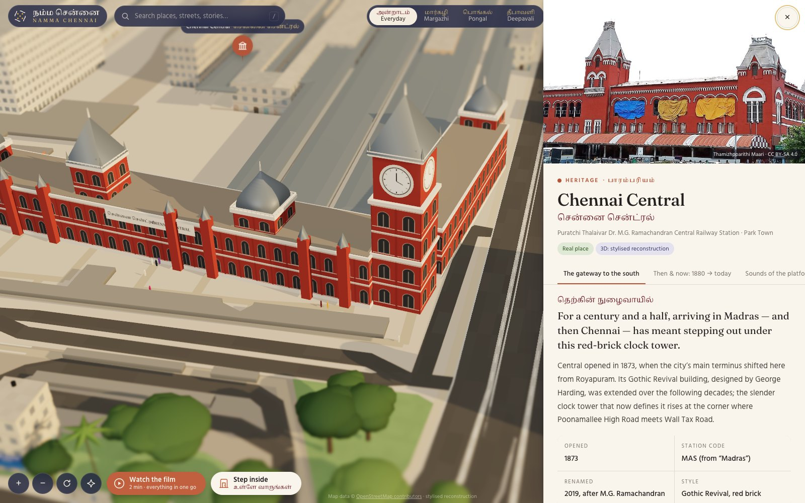<br><sub><b>Every landmark has a story.</b> Real Wikimedia photographs with the author and licence shown, plus the history.</sub></td>
    <td>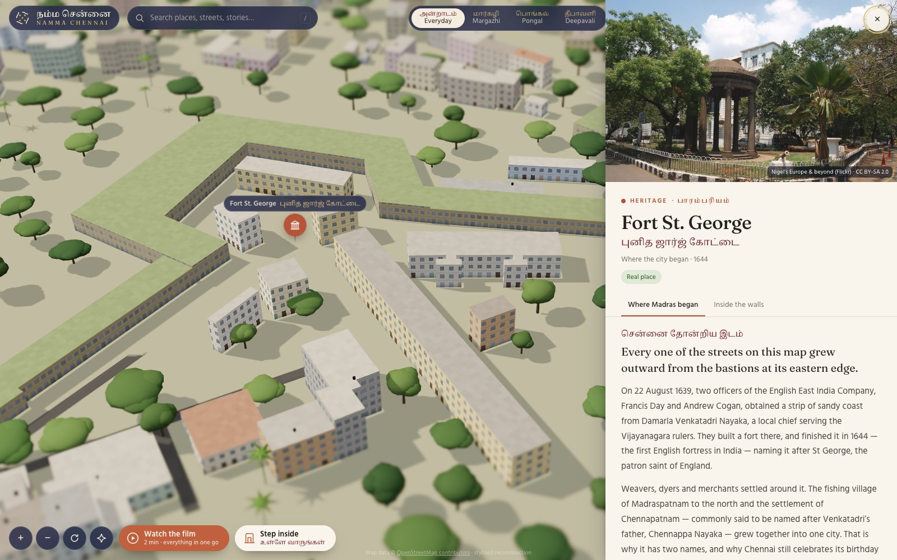<br><sub><b>Fort St. George, 1644.</b> Where the city began, told in chapters.</sub></td>
  </tr>
  <tr>
    <td>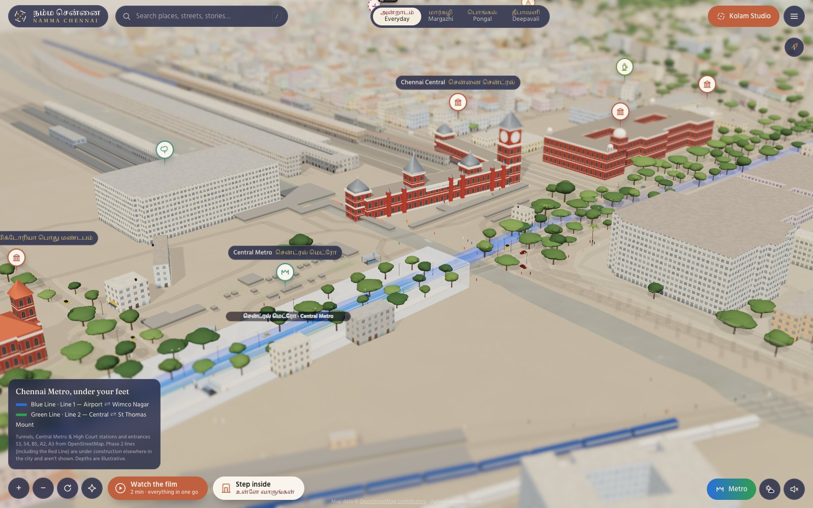<br><sub><b>Metro x-ray.</b> The real Blue and Green Line tunnels under Central. Lines that aren't built yet are left out.</sub></td>
    <td>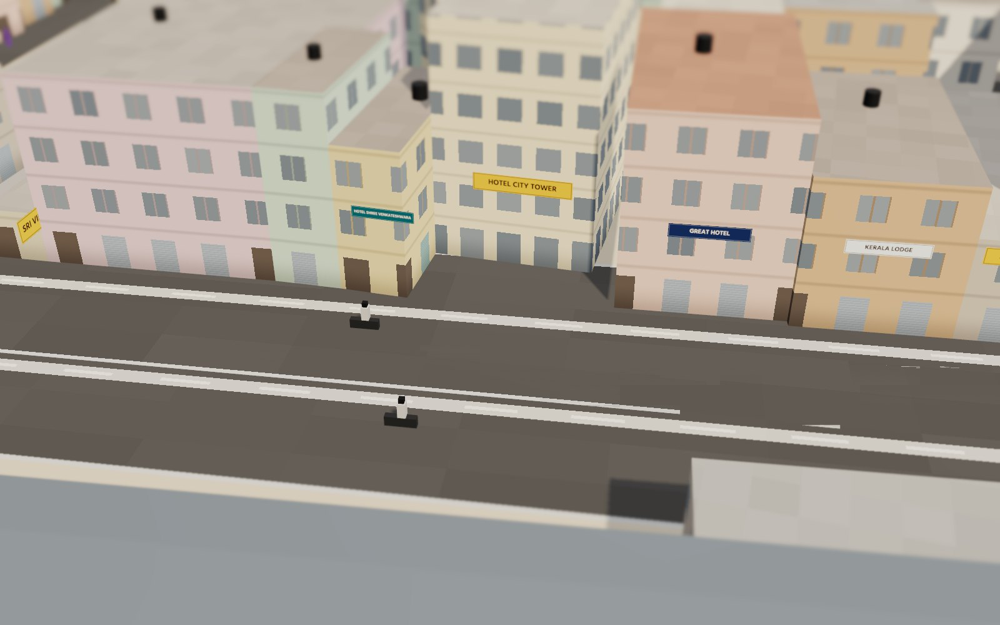<br><sub><b>Real names on the street.</b> About a hundred hotels, lodges and shops carry their real OSM names.</sub></td>
  </tr>
  <tr>
    <td>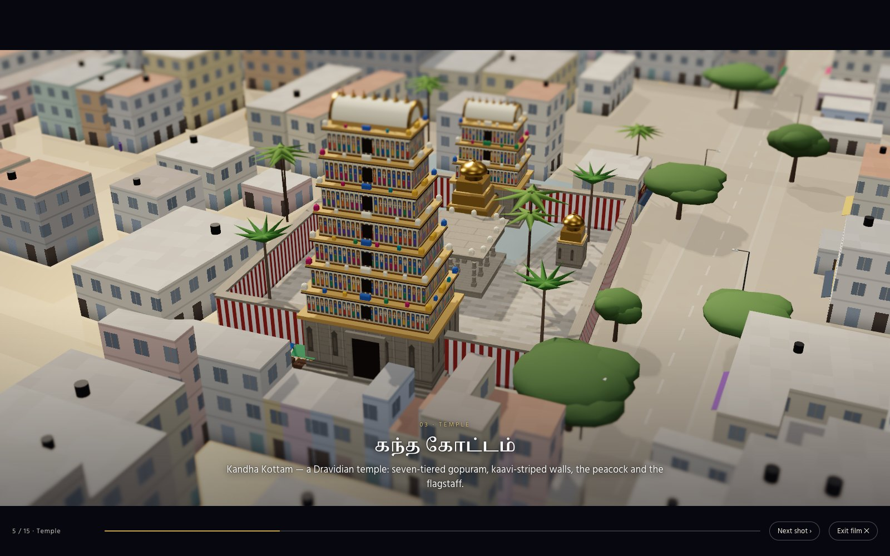<br><sub><b>Watch the film.</b> A two-minute guided showreel in letterbox with Tamil and English subtitles.</sub></td>
    <td>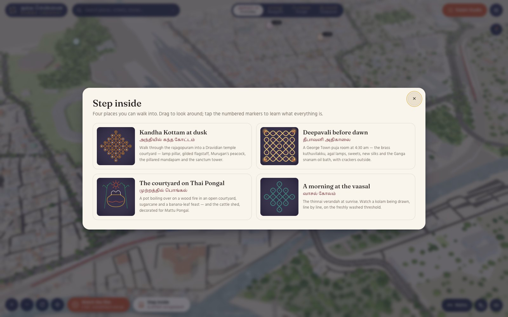<br><sub><b>Four places to walk into</b>, each with numbered markers that explain what you're looking at.</sub></td>
  </tr>
</table>

### Kolam Studio → postcard

<table>
  <tr>
    <td width="50%">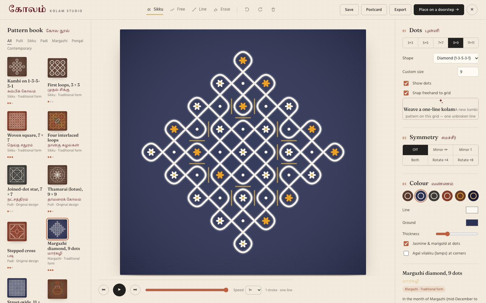<br><sub><b>Kolam Studio.</b> Sikku kolams worked out as mirror curves. It can search for a pattern drawn as one unbroken line.</sub></td>
    <td width="50%"><br><sub><b>The postcard.</b> One uploaded PNG. The rest of the card, including the Tamil text, the postmark and the border, is Cloudinary transformations.</sub></td>
  </tr>
</table>

### On a phone

<p align="center">
  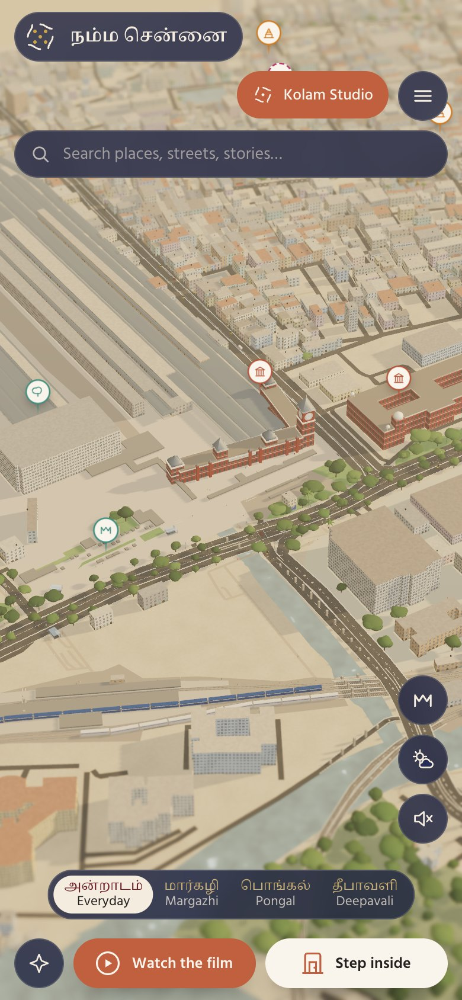
  &nbsp;&nbsp;
  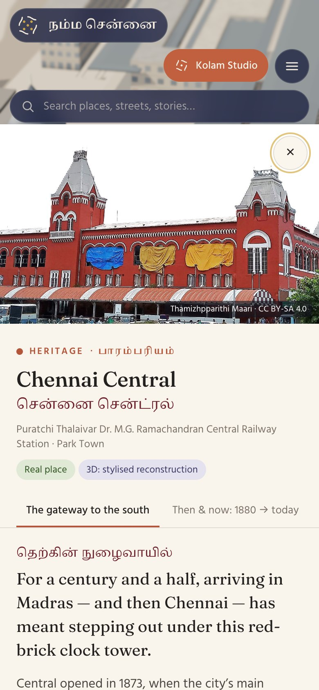
</p>

---

## Tech stack

| Layer | Tool | What it does here |
|---|---|---|
| 3D engine | **Three.js r169** | Draws the whole city: a custom building shader, instanced trees and traffic, bloom, tilt-shift and a screen-space rain pass. There are no downloaded 3D models. Everything is generated in code. |
| Animation | **GSAP 3** | Camera flights, festival changes, the film, lightning timing |
| Build | **Vite 5** | Dev server and a static production build |
| Map data | **OpenStreetMap** | 2,449 buildings, 795 roads, railways, the Cooum, metro tunnels and real names, preprocessed into a ~450 KB JSON file by `scripts/build-geo.mjs` |
| Media | **Cloudinary** | Every image you see, every upload, the postcards, AI tags and the share card (details below) |
| Archive photos | **Wikimedia Commons** | Openly licensed photographs, credited wherever they appear |
| Sound | **Web Audio API** | City hum, temple bells, train horns, rain and thunder, all generated in the browser |
| Screenshots | **Playwright** | `npm run screenshots` captures every image in this README from the real app |
| Language | **Plain JavaScript (ES modules)** | No framework and no backend. One HTML file. |

---

## How we use Cloudinary

Cloudinary is how every picture in the app gets delivered. There's no server, so the browser talks to Cloudinary directly, using only a cloud name and an **unsigned** upload preset.

| Feature | Cloudinary feature | How it works | Where |
|---|---|---|---|
| **Archive photos** | Fetch delivery + transformations | Wikimedia originals are fetched through Cloudinary and sized for each place they appear: a 96px pin, a thumbnail, a story header, a full-screen view. All use `f_auto,q_auto`, and `g_auto` crops around the subject. | `src/media/cloudinary.js` |
| **Responsive images** | `srcset` with width transforms | Each preset generates several widths so phones download small files. | `img()` / `srcset()` |
| **Visitor memories** | Unsigned upload API | Photos, video and audio upload with tags (`namma-chennai`, category, festival, place) and context metadata (caption, story, place, display name). | `upload()` |
| **Everyone's memories on the map** | Client-side resource list | `/image/list/namma-chennai.json` and `/video/list/…` are read on load, and each memory becomes a pin next to its place. | `listTagged()` |
| **AI auto-tagging** | Google / Amazon auto-tagging add-on | Tags such as *oil lamp*, *cattle* or *pattern* come back on upload. The app shows them and uses them to file a memory under Deepavali, Pongal or Margazhi when the visitor didn't choose one. | `aiTagsOf()`, `festivalFromTags()` |
| **Kolam postcards** | Text overlays, padding, rotation, borders | The kolam uploads once as a PNG. `c_pad` makes the 1800×1100 card. Text layers in Hind Madurai (Tamil) and Playfair Display add the greeting and your name. `a_-14` tilts a "CHENNAI · 600 003" postmark, and `bo_16px` adds the gold border. The result is one permanent URL. | `src/media/postcard.js` |
| **Shared kolams** | Upload + context metadata | A placed kolam carries its pattern data, so other visitors see it drawn on a doorstep in their own city. | `src/kolam/studio.js` |
| **Video** | Video delivery | Automatic format and quality, with a generated poster frame. | `src/media/cloudinary.js` |
| **Share card (Open Graph)** | Crop, `e_gradient_fade`, text layers | A render of the city is cropped to 1200×630, faded to indigo on the left, and titled in Tamil and English. | `index.html` |
| **Graceful fallback** | — | At startup the app checks whether fetch delivery is allowed. If it isn't, photos load straight from Wikimedia and nothing breaks. | `probeFetch()` |

### Setting it up

1. **Cloud name.** It's at the top left of your Cloudinary dashboard.
2. **Unsigned upload preset.** Settings → Upload → Upload presets → Add. Set *Signing mode* to **Unsigned**.
3. **Allow the resource list.** Settings → Security → untick **Resource list** under restricted media types.
4. **Allow fetched URLs.** On the same page, untick **Fetched URL**. You can also limit fetch to `upload.wikimedia.org` and `commons.wikimedia.org`.
5. **AI auto-tagging (optional).** Register Google Automatic Image Tagging or Amazon Rekognition under Add-ons, then enable it in your upload preset with a confidence threshold of about 0.6.
6. **Add the values:**

```bash
cp .env.example .env.local
```

```ini
# .env.example
# Your Cloudinary cloud name (Dashboard → top-left)
VITE_CLOUDINARY_CLOUD_NAME=

# An UNSIGNED upload preset (Settings → Upload → Upload presets)
VITE_CLOUDINARY_UPLOAD_PRESET=

# Folder uploads land in (optional)
VITE_CLOUDINARY_FOLDER=namma-chennai
```

> **Never put your API key or API secret here.** Anything starting with `VITE_` is bundled into browser code. The app is designed so it never needs them.

The app works without Cloudinary too. Photos fall back to Wikimedia, and the upload button explains why it's off. You can also paste a cloud name and preset under Menu → Cloudinary settings to try it in your own browser.

---

## Running it

You need Node 18 or newer.

```bash
npm install
npm run dev
```

Open http://localhost:5173. The first load takes a few seconds while the city is assembled in your browser.

```bash
npm run build         # static site in dist/
npm run preview       # serve dist/ locally
npm run screenshots   # re-capture the README images (needs Google Chrome)
```

`dist/` is a plain static site, so it runs on Netlify, Vercel, GitHub Pages or Cloudflare Pages.

Deep links: `/#place=central`, `/#place=kandhakottam`, `/#place=home-pongal`, `/#studio`.

---

## What's in it

**The city.** Real streets and building footprints. One shader adds floors, windows, rolling shutters, lit windows at night and black water tanks on the terraces. Blocks that OSM hasn't mapped yet are filled with plain low-rise houses, and those are labelled as estimated.

**Landmarks.** Chennai Central, Ripon Building, Victoria Public Hall, Southern Railway HQ, Fort St. George and **Kandha Kottam**. The temple is the centrepiece: a seven-tier gopuram with rows of tiny shrines, a lamp pillar, a flagstaff, the peacock, a pillared hall, its real tank, and flower stalls outside the gate.

**The street.** Shop boards in Tamil and English suited to each neighbourhood, about a hundred real business names, blue Corporation street boards, autos and buses driving on the left, and suburban EMUs pulling into Central.

**Festivals.**
- **Everyday:** a small white kolam at many doorsteps.
- **Margazhi:** large kolams at dawn.
- **Pongal:** pots, sugarcane, thoranams and decorated cattle.
- **Deepavali:** lamps, star lanterns, ground crackers and fireworks.

**Time and weather.** Six times of day, from dawn to night. The weather can be clear, haze, monsoon rain or a thunderstorm. In a storm, lightning strikes the tallest buildings and the thunder arrives late after each flash.

**Step inside.**
- **The temple at dusk.** The deity isn't shown, on purpose.
- **A puja room before dawn on Deepavali.**
- **A Pongal courtyard.** You can step through all four days, from Bhogi to Kaanum Pongal.
- **A thinnai doorstep.** A kolam draws itself on the washed threshold.

**Kolam Studio.**
- **Mirror-curve sikku kolams,** with a search that finds a pattern drawn as one unbroken line.
- **Drawing tools:** freehand and dot-to-dot, with symmetry tools.
- **Presets:** 13, each labelled honestly as a traditional form or our own design.
- **Playback** of how the kolam is drawn.
- **Export** as PNG or SVG.
- **Place it on a doorstep** in the city.
- **Postcards**, made by Cloudinary.

**The film.** A two-minute guided tour across all of it. You can skip a shot or leave at any time.

**And more.** Guided journeys and Then & Now photo pairs. An atlas of places beyond the map. Search across everything. A browser-made soundscape, keyboard controls, a reduced-motion setting and a full mobile layout.

---

## What's real and what isn't

We cared about this, so here it is plainly.

- **Real:** street layout, building footprints, railway, river, canal, temple tanks, metro tunnels and entrances, and the names of buildings, shops and streets. Taken from OpenStreetMap in November 2026.
- **Estimated:** building heights where OSM has none, and the infill houses (labelled).
- **Stylised:** every landmark. Each one follows the real building's character, not its measurements.
- **Illustrative:** the family homes. Their stories are composites, and each one is marked as such. No real family or address is shown.
- **Left out on purpose:** the deity in the sanctum, the proposed high-speed rail station, and metro lines that aren't built yet.
- **Privacy:** memories attach only to public places, never to houses.

---

## Project layout

```
index.html              page, UI markup, SEO and Open Graph tags
src/
  main.js               boots everything and wires the UI
  core/                 renderer, camera, post-processing
  world/                city, landmarks, temple, metro, traffic, weather, festivals, signs
  interior/             the step-inside scenes
  kolam/                kolam engine, presets, studio
  content/              places, stories, tours, media registry
  media/                Cloudinary delivery, uploads, postcards
  audio/                the soundscape
  ui/                   story panel, pins, search, modals, film
scripts/
  build-geo.mjs         OSM extract → public/data/city.json
  screenshots.mjs       Playwright capture for this README
```

---

## Developer

<table>
  <tr>
    <td width="120" align="center">
      
    </td>
    <td>
      <b>Prodhosh VS</b><br>
      Designed and built Namma Chennai.<br><br>
      🌐 <a href="https://prodhosh.me">prodhosh.me</a> &nbsp;·&nbsp;
      💼 <a href="https://www.linkedin.com/in/prodhoshvs">linkedin.com/in/prodhoshvs</a> &nbsp;·&nbsp;
      🐙 <a href="https://github.com/prodhosh">github.com/prodhosh</a>
    </td>
  </tr>
</table>

---

## Credits

- Map data © OpenStreetMap contributors, under the Open Database License.
- Photographs from Wikimedia Commons, each credited where it appears. The full list is in `src/content/media.js`.
- Fonts under the SIL Open Font License.

<p align="center"><i>யாதும் ஊரே யாவரும் கேளிர்</i><br><sub>Every town is our town, everyone our kin. (Kaniyan Pungundranar, Purananuru 192)</sub></p>
